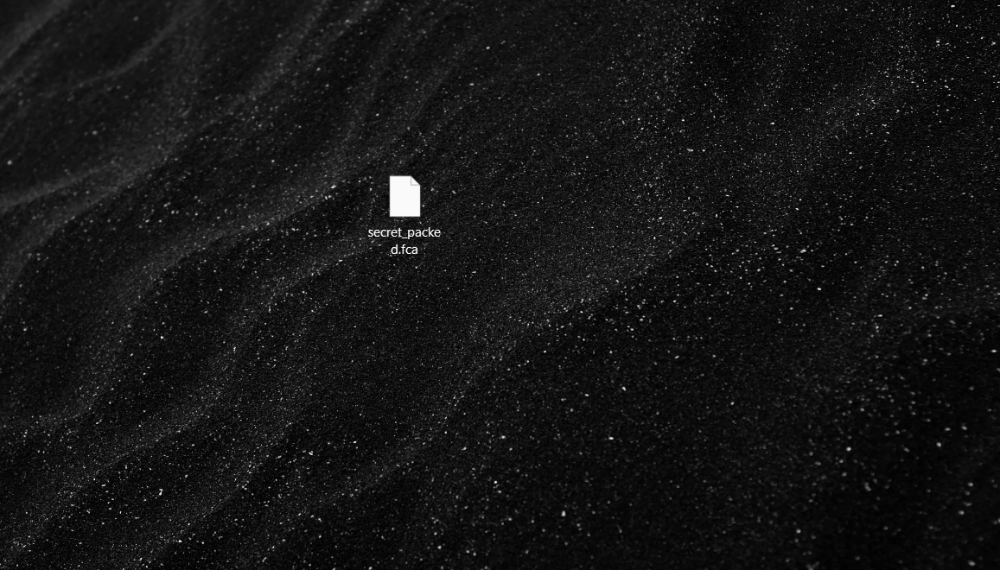
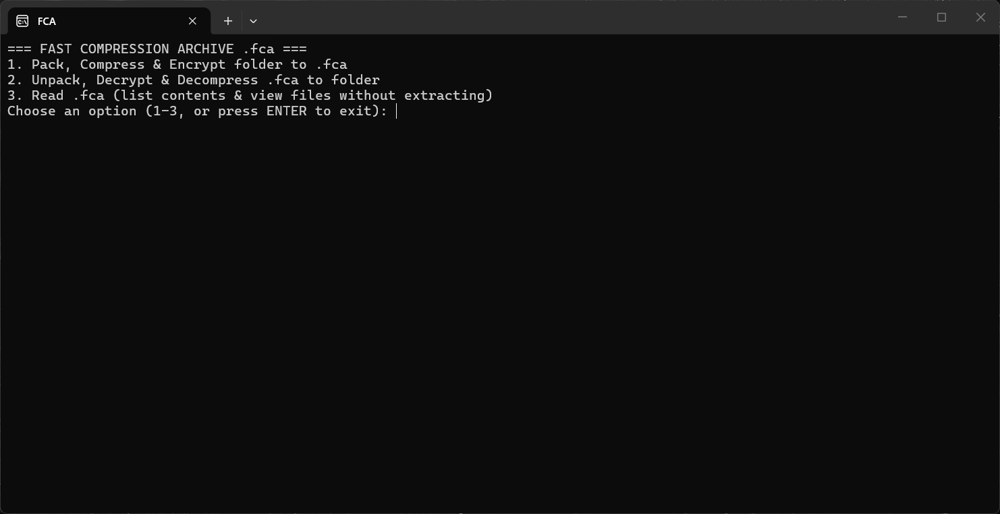
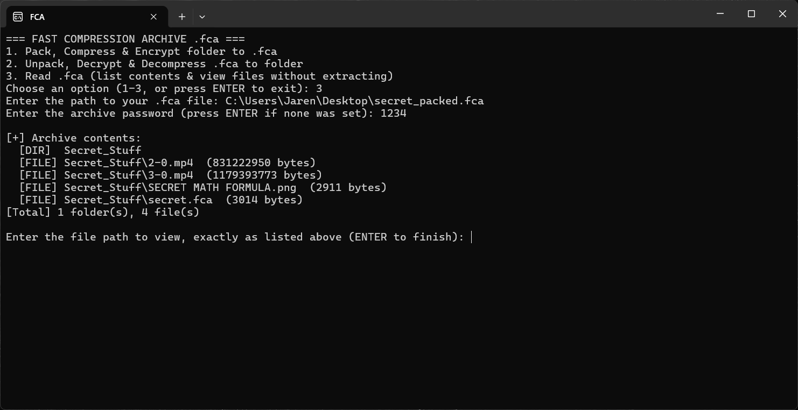
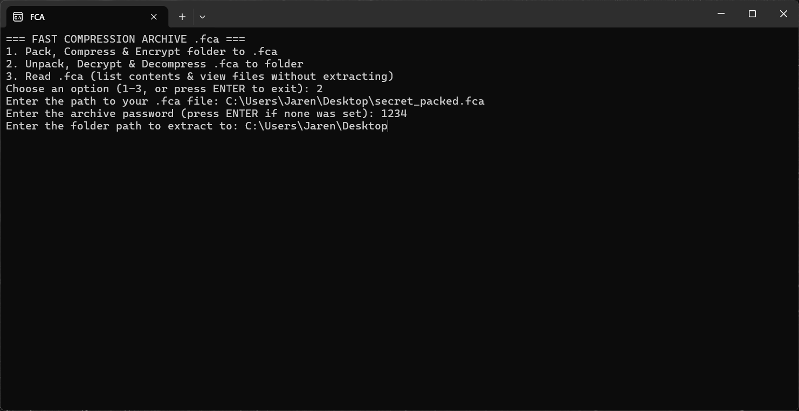
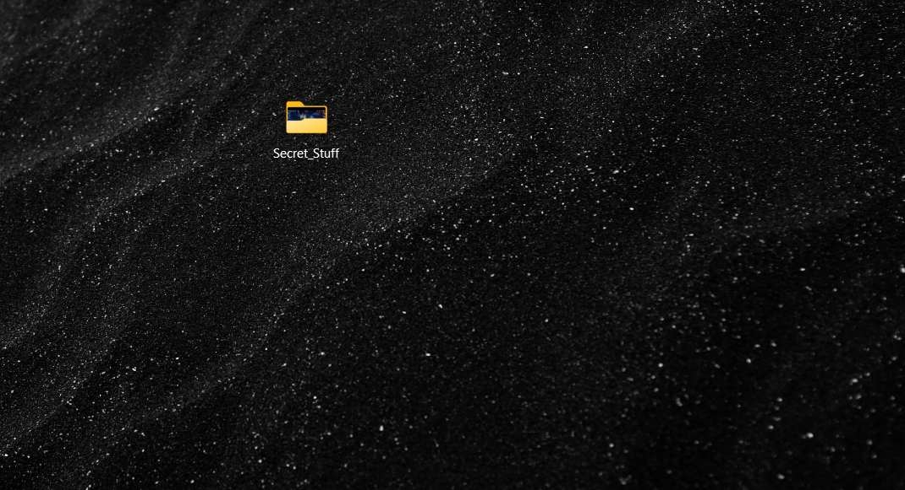

w# Fast Compression Archived

Hello! This is a new Project of Mine. My goal is to make a simple Project that won't me get or cost money.
I decided to make this test project to sharpen my C++ Profession, and I don't really need money for this.
This project took me 2 days. But, after a bunch of bugs, decryption failure 
and a lot of file corruption. I did some research, Watched some tutorials, and I finally came up with probably a good one.

Also this is still in the incomplete state. Meaning there are still stuff to add

## Changelog:
Aug 8 2026 v1.01: 
  - Released the Beta Version!
  - Paused Development

Oct 30 2026 v1.02:
  - Project Resumed
  - Bug Fixes (Random Crashes when Unpacking)

Oct 31 2026 v1.03:
  - Added the new feature to read the packed folder

## Info
This is Folder Compressor program. (Like zip, rar, etc.)
But its file extension is ".fca" which is short for Fast Compression Archived.
It uses AES-256 + HMAC-SHA256 encryption to make sure it's safe and sound!
You can also add a Password to your Packed Archive. (Make sure it's not 1234)
This is Written in C++! And it only took 2 days. From Aug 5 to 6. (Also my fastest project yet)

Only Available in Windows. I will add universal support soon. Stay tuned for it!

# Tutorial

Below is a full manual just incase if it gets too confusing.

## How to Pack a folder

1. When opening the FCA application, you will see a simple menu like this:

You're going to type '1' to the command line, and click enter.

---

2. Next you're going to Add the following information:
  - Folder path
  - Output path
  - Encryption Password (Optional)

    
Please avoid Spaces to the path. If there are ever spaces, I suggest replacing the
spaces with underscores (_)

When adding the path, remove the quotes if you ever used the "Copy as Path" method.
(e.g: "C:\Users\Main\Desktop\secret.fca")

---

3. After that, you should get kicked out of the Command Prompt. Check the output directory you used
   if the pack is there. If it's there, it worked. If not, you may did something wrong or the program has a bug.

## How to Unpack a folder (and also how to check what's inside it)

1. When opening the FCA application you will see a simple menu like this:

Before we click 2, you may need to do '3' (or reading) before unpacking it.
You're going to type '3' to the command line, and click enter.

But if you wanna skip the reading part, go on to Step 3.

---

2. Next you're going to Add the following information:
  - .fca path (The one you want to read and unpack)
  - Encryption Password (If there's one)

You're supposed to see the list of files inside the folder. If you get kicked out of the Command Prompt, 
you may did something wrong or the program has a bug. It can also read the folder inside that encrypted folder.
Now we confirmed no bombs or anything, you can click enter. It should kick you out of the Command Prompt.

---

3. You will need to reopen the FCA application once again. This time, type '2' and click enter.

---

4. Next you're going to Add the following information:
   - .fca path (The one you want to read and unpack)
   - Encryption Password (If there's one)
   - Extract path

  

  ---

5. After that, you should get kicked out of the Command Prompt. You're going to check the path
   you placed in the Extract path. If it's there, it worked. If not, you may did something wrong or the program has a bug.

---

If there are any bugs, please tell it to me [via e-mail.](mailto:jarbodude@gmail.com) I would appreciate that so
we can always keep this project fixed, and well done!
