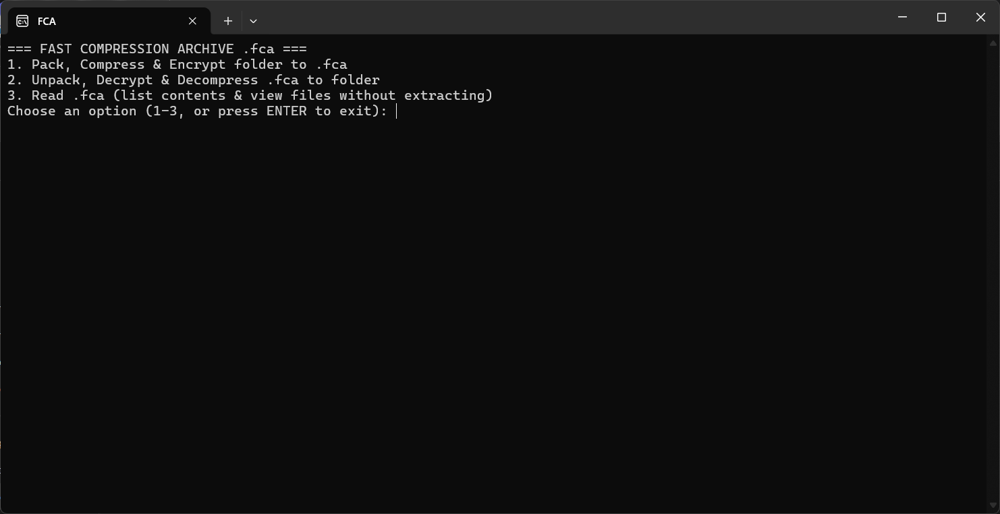
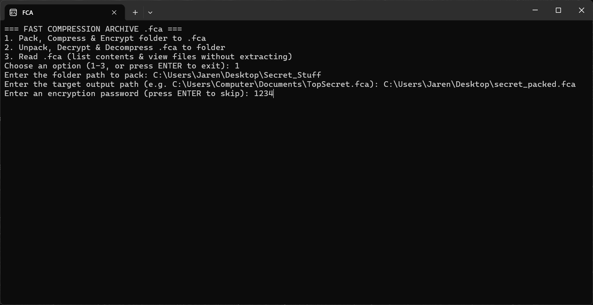

# Fast Compression Archived

Hello! This is a new Project of Mine. My goal is to make a simple Project that won't me get or cost money.
I decided to make this test project to sharpen my C++ Profession, and I don't really need money for this.
This project took me 2 days. But, after a bunch of bugs, decryption failure 
and a lot of file corruption. I did some research, Watched some tutorials, and I finally came up with probably a good one.

## Changelog:
Aug 8 2026 v1.01: 
  - Released the Beta Version!

Oct 30 2026 v1.1:
  - Bug Fixes (Random Crashes when Unpacking)

## Info
This is Folder Compressor program. (Like zip, rar, etc.)
But its file extension is ".fca" which is short for Fast Compression Archived.
It uses AES-256 + HMAC-SHA256 encryption to make sure it's safe and sound!
You can also add a Password to your Packed Archive. (Make sure it's not 1234)
This is Written in C++! And it only took 2 days. From Aug 5 to 6. (Also my fastest project yet)

Only Available in Windows. I will add universal support soon. Stay tuned for it!

# Tutorial

Below is a full manual just incase if it gets too confusing.

## How to Pack a folder

1. When opening the FCA application, you will see a simple menu like this:

You're going to type '1' to the command line, and click enter.

2. Next you're going to Add the information:
  - Folder path
  - Target Output
  - Encryption Password

    
Please avoid Spaces to the path. If there are ever spaces, I suggest replacing the
spaces with underscores (_)

When adding the path, remove the quotes if you ever used the "Copy as Path" method.
(e.g: "C:\Users\Main\Desktop\secret.fca")
